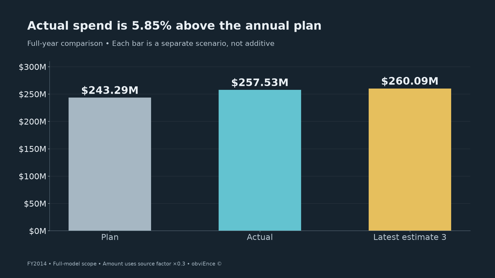
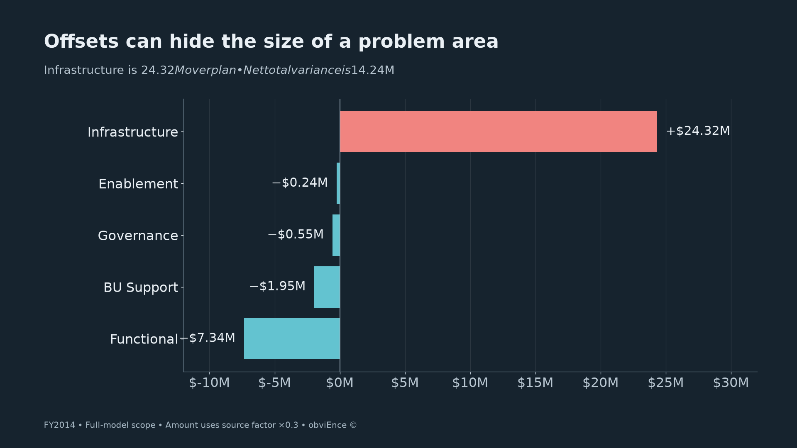
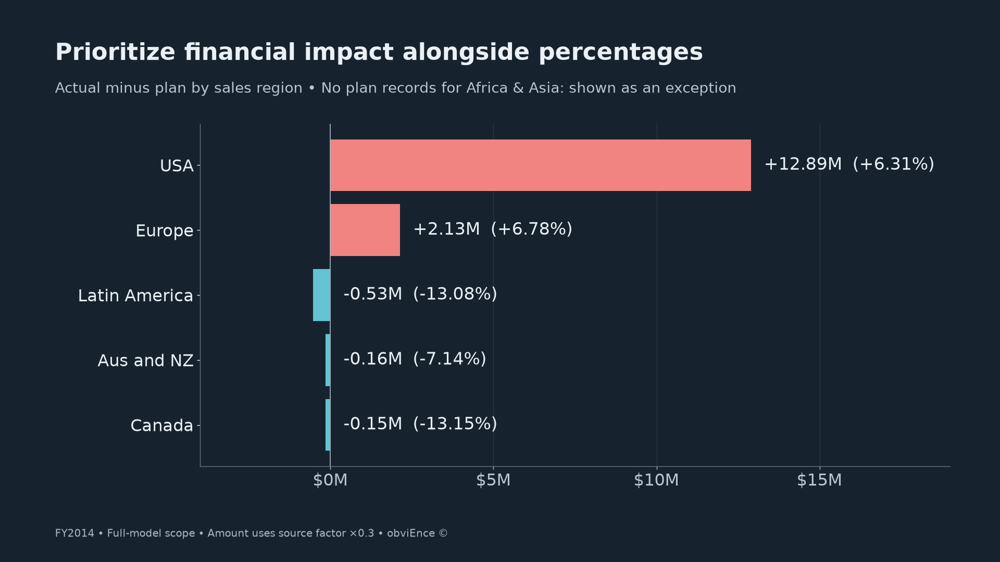
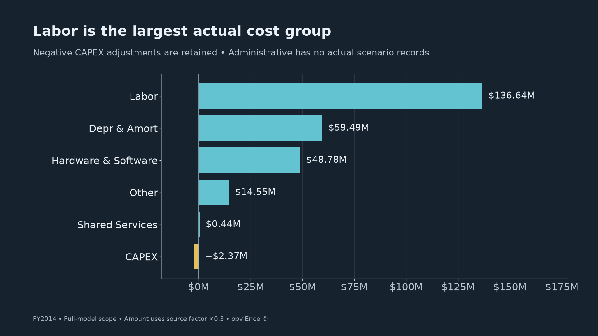

# IT Expenditure Analysis (Power BI + Variance & Root-Cause Review)

Analysis of **FY2014 IT expenditure** (`166,216` scenario-level records across **12 months**) using the Microsoft **IT Spend Analysis Sample** dataset (*obviEnce ©*), comparing **Actual** spending (`$257.53M`) against **Original Plan** (`$243.29M`) and forecast snapshots (**LE1–LE3**), diagnosing the **+$14.24M (+5.85%)** budget overrun across IT areas, business areas, sales regions, and cost element groups, and flagging accounting exceptions before executive action.

## Video Presentation
- **MP4 in this repo:** [`IT_Expenditure_Analysis_Presentation.mp4`](./IT_Expenditure_Analysis_Presentation.mp4) (7 min 49 sec, 1920×1080, ~30.2 MB, with burned-in captions)
- **Subtitles & Transcript:** [`IT_Expenditure_Captions.srt`](./IT_Expenditure_Captions.srt) | [`IT_Expenditure_Captions.vtt`](./IT_Expenditure_Captions.vtt) | [`Presentation_Transcript.md`](./Presentation_Transcript.md)

---

## 1. Business Objective & Dataset Scope
**Goal:** Monitor IT expenditure against annual budgets and updated forecast estimates, pinpoint where cost deviations sit, separate true operational variance from accounting adjustments, and establish an accountable drilldown sequence in Power BI.

- **Period Covered:** January–December 2014 (`FY2014`, 12 monthly snapshots)
- **Fact Volume:** `166,216` scenario-level records (`Actual`, `Plan`, `LE1`, `LE2`, `LE3` — alternative scenario views, not additive)
- **Included Source & Analysis Deliverables:**
  - [`source/IT Spend Analysis Sample.pbix`](./source/IT%20Spend%20Analysis%20Sample.pbix) — Original Power BI Desktop report
  - [`source/IT Spend Analysis Sample.xlsx`](./source/IT%20Spend%20Analysis%20Sample.xlsx) — Source Excel workbook with Power Pivot model
  - [`IT_Expenditure_Reimport.xlsx`](./IT_Expenditure_Reimport.xlsx) — Extracted portable Excel star schema (`Fact`, 7 dimension tables, and attribution `Info` tab)
  - [`PowerBI_Measures.dax`](./PowerBI_Measures.dax) — Extracted DAX measures (`Amount`, `Actual`, `Plan`, `LE1–LE3`, variance & diagnostic checks)
  - [`analysis/`](./analysis) — Validated JSON/CSV summaries, schema, relationships, and data quality audit

---

## 2. Data Model, DAX Logic & Data Quality (`analysis/data-quality.json`)

### Star Schema & Relationships
One central `Fact` table connects to **7 reporting dimensions** via **7 active many-to-one (`M:1`), single-direction relationships**:
- `Date` (`48` source month entries; `12` months in FY2014 scope)
- `IT Area` (`5` areas / `40` subareas total; `38` active subareas in facts)
- `Scenario` (`5` scenarios: `Actual`, `Plan`, `Latest Estimate 1–3`)
- `Business Area` (`7` members; note: distinct dimension from `IT Area`, even where both contain `Infrastructure`)
- `Country Region` (`52` members total across `6` sales regions; `35` used in facts)
- `Cost Element` (`253` members across `7` cost element groups; `240` used in facts)
- `Department` (`471` members total; `410` used in facts)

### Key DAX Calculations (`PowerBI_Measures.dax`)
| Measure | DAX Expression | Analytical Rule |
| --- | --- | --- |
| **Amount** | `TOTALYTD(SUM([Value]), 'Date'[Date])*.3` | Preserves the report's year-to-date `×0.3` scaling factor |
| **Var Plan** | `[Actual] - [Plan]` | Positive = spend above plan (`$14.24M`) |
| **Var Plan %** | `DIVIDE([Var Plan], [Plan], BLANK())` | Requires a meaningful positive plan baseline |
| **Var LE3 / %** | `[Actual] - [LE3]` / `DIVIDE([Var LE3], [LE3], BLANK())` | Measures alignment against final forecast (`-$2.57M` / `-0.99%`) |

### Data Preparation & Integrity Checks
- **Excel vs. PBIX Reconciliation:** `166,216` Excel fact rows and unscaled totals match the PBIX model.
- **Completeness & Keys:** `0` null fact fields, `0` exact duplicate rows, and `0` unmatched foreign keys across all dimension joins.
- **Sign Preservation:** Retained `9,810` negative-value adjustment rows and `9,801` zero-value rows without imputation so reported net costs remain exact and missing plan scenarios stay distinct from recorded zero spend.

---

## 3. Core Findings (FY2014, Scaled Report Scope)

### Full-Year Financial Summary
| Scenario | Full-Year Cost | vs. Actual Variance | vs. Actual Variance % |
| --- | ---: | ---: | ---: |
| **Actual** | **$257.53M** | — | — |
| **Original Plan** | **$243.29M** | **+$14.24M** | **+5.85%** |
| **Latest Estimate 1 (LE1)** | $242.83M | +$14.70M | +6.05% |
| **Latest Estimate 2 (LE2)** | $257.37M | +$0.16M | +0.06% |
| **Latest Estimate 3 (LE3)** | **$260.09M** | **-$2.57M** | **-0.99%** |

- **Timing of Budget Gap:** Cumulative YTD variance widens steadily across the year, finishing at **+$14.24M** by December (`LE2` proved closest to final actuals, while `LE3` overshot actuals by `$2.57M`).

### IT Area & Offsetting Variance Analysis

| IT Area | Actual | Plan | Variance ($) | Variance % | Share of Actual |
| --- | ---: | ---: | ---: | ---: | ---: |
| **Infrastructure** | **$74.98M** | **$50.66M** | **+$24.32M** | **+48.02%** | 29.1% |
| **Functional** | $79.72M | $87.06M | -$7.34M | -8.43% | 31.0% |
| **BU Support** | $75.74M | $77.70M | -$1.95M | -2.51% | 29.4% |
| **Governance** | $14.45M | $15.01M | -$0.55M | -3.70% | 5.6% |
| **Enablement** | $12.62M | $12.86M | -$0.24M | -1.84% | 4.9% |

- **Masking Effect:** Infrastructure alone is **+$24.32M (+48.02%)** over plan — exceeding the total organizational net variance (`+$14.24M`). The other four IT areas are collectively **$10.08M below plan**, partially masking Infrastructure's overrun in the top-line `+5.85%` number.
- **Dimension Caution:** Under the separate **Business Area** dimension, *Infrastructure* shows **+44.37%** variance (`$76.58M` actual vs. `$53.04M` plan, `+$23.54M`), illustrating why dimension selection must always be named explicitly.
- **Subarea Spotlight (`Networking`):** `Networking` stands out within IT subareas at **$15.19M actual vs. $8.63M plan (+$6.55M / +75.88%)**.

### Regional Expenditure Analysis

- **USA:** `$217.34M` actual (**84.4%** of total cost) vs. `$204.44M` plan -> **+$12.89M (+6.31%)** (largest dollar exposure)
- **Europe:** `$33.53M` actual vs. `$31.40M` plan -> **+$2.13M (+6.78%)** (slightly higher `%` variance, smaller dollar weight)
- **Below-Plan Regions:** **Canada** (`-13.15%`, `-$0.15M`), **Latin America** (`-13.08%`, `-$0.53M`), and **Aus and NZ** (`-7.14%`, `-$0.16M`) require delivery confirmation before assuming true savings vs. deferred timing.
- **Exception Flag (`Africa & Asia`):** `$0.061M` actual expenditure with **no original plan records**; excluded from standard `%` rankings.

### Cost Element Groups & Accounting Exceptions

- **Labor (`$136.64M`):** Largest cost element at **53.1%** of net actual expenditure, finishing **`-2.29%` (-$3.21M)** below its `$139.85M` plan.
- **Depr & Amort (`$59.49M`, `-9.17%`)** and **Hardware & Software (`$48.78M`, `-1.12%`)** follow in scale.
- **Shared Services (`$0.44M` vs. `$1.05M` plan, `-58.29%`):** Steep relative underspend requiring service-volume and allocation checks.
- **Accounting Exceptions Retained Without Imputation:**
  - **Administrative cost group:** Negative original plan adjustments (`-$25.21M`) with no actual scenario records (`+$25.21M` offset).
  - **Core Infrastructure subarea:** `$8.77M` actual spend against a negative plan (`-$6.53M`).
  - **CAPEX:** Retained negative credit adjustments (`-$2.37M` actual vs. `-$1.62M` plan).

---

## 4. Repeatable Power BI Review Sequence & Action Plan
1. **Overview Check:** Confirm year (`FY2014`) and `×0.3` cost scope; benchmark `Actual` against both `Plan` and `LE3`.
2. **Regional Prioritization:** Drill into **USA** (`+$12.89M`) first, then **Europe** (`+$2.13M`), for maximum dollar impact.
3. **IT Area & Subarea Investigation:** Audit **Infrastructure** adjustments (`+$24.32M`) and **Networking** contracts/scope changes (`+$6.55M` / `+75.88%`).
4. **Accounting & Allocation Validation:** Verify **Administrative**, **Core Infrastructure**, and **Africa & Asia** exceptions separately; validate whether **Shared Services**, **Canada**, and **Latin America** underspends represent true efficiency or shifted timelines.
5. **Accountable Ownership:** Track monthly plan variance and forecast error (`LE1–LE3`) with named owners for each explanation.

---

*Attribution: Source dataset and original report sample belong to Microsoft's public IT Spend Analysis Sample (**obviEnce ©**).*
